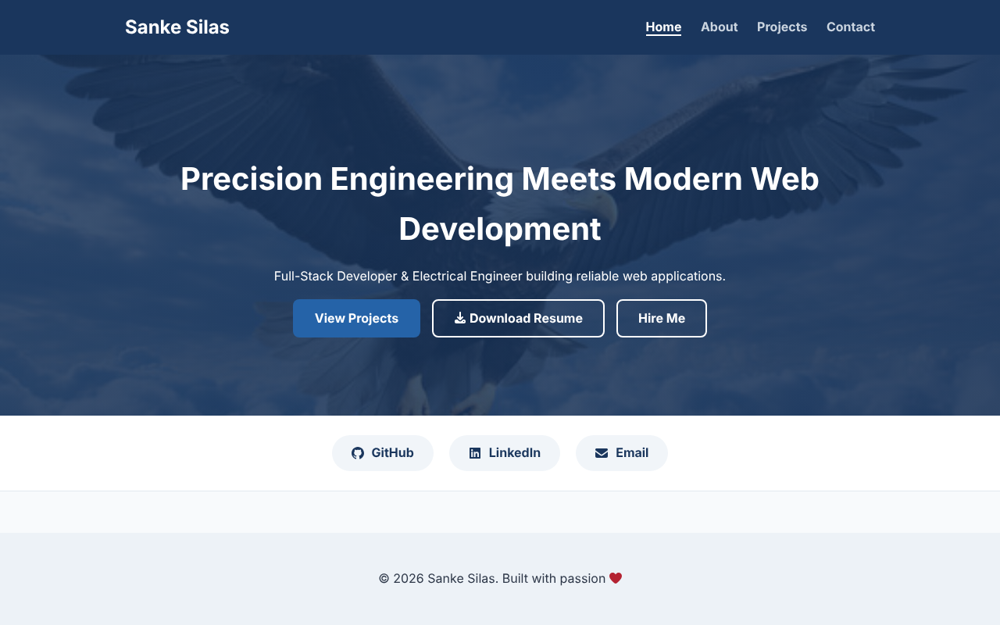
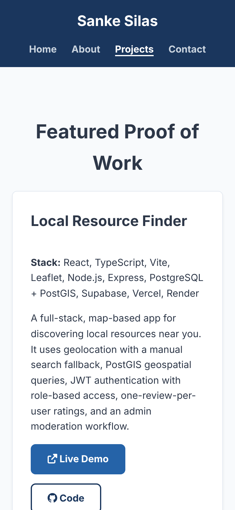

# Sanke Silas Portfolio

Personal portfolio of Sanke Silas, a full-stack developer and electrical engineer. It has a home page, an about page, a projects page with live demos and source links, and contact details.

**Live site:** https://sankeportfolio.vercel.app





## Built with

- [Eleventy](https://www.11ty.dev/) (Nunjucks templates) for a static build
- Semantic HTML5
- Plain CSS with custom properties, responsive layout and visible focus styles
- Inline SVG icons from [Font Awesome Free](https://fontawesome.com/) (CC BY 4.0)
- Prettier for formatting
- Deployed on Vercel

## Project structure

```text
src/
  _data/site.json        site name, URL, navigation, share image
  _data/projects.json    every project shown on the Projects page
  _includes/layouts/     base layout (head, meta tags, skip link)
  _includes/partials/    header and footer, written once and used on every page
  images/                hero image, share image, project screenshots
  *.njk                  the four pages
eleventy.config.js       build settings and the icon / projectImage helpers
vercel.json              build command and output folder for Vercel
```

## Run locally

```sh
npm install
npm start
```

Open the address Eleventy prints (usually http://localhost:8080). The site rebuilds when you save a file.

To create the production build in `_site/`:

```sh
npm run build
```

## Add or edit a project

1. Add an entry to `src/_data/projects.json`. `slug`, `title` and `description` are required. `stack`, `badge`, `liveUrl`, `repoUrl`, `extraLinks`, `repoNote` and `focus` are optional.
2. Optional: save a screenshot as `src/images/projects/<slug>.png` (or `.webp` / `.jpg`), 1280x800. It appears on the card automatically, with alt text from `imageAlt` or the project title.

## Formatting

```sh
npm run format        # fix formatting
npm run format:check  # only check
```

Prettier covers CSS, JS, JSON and this README. The `.njk` templates use 4-space indentation by hand.

## Deployment

Vercel reads `vercel.json`: build command `npm run build`, output directory `_site`. Pushing to the production branch deploys the site. The share image and canonical URLs use the domain in `src/_data/site.json`, so update `url` there if the domain changes.

## Accessibility and SEO

- One `h1` per page, skip-to-content link, `aria-current` on the active page
- External links use `rel="noopener noreferrer"`
- Description, Open Graph and Twitter card tags and a canonical link on every page
- Icons are decorative and hidden from screen readers
